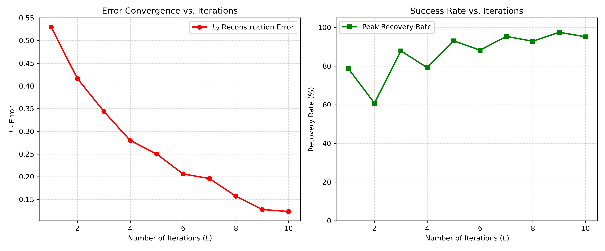

# Sparse FFT — Algorithms and Experiments

**SCUPI ECE Analysis course project · MATLAB / Python · Signal processing**

An educational study of sparse Fourier recovery under the guidance of Prof. Hao Qin, with MATLAB implementation modules and Python experiments illustrating hashing, filtering, and repeated estimation.

This is a course project and literature study. The repository does not establish a new recovery theorem, a general deterministic guarantee, or a measured end-to-end speedup over FFT.

## Contents

| Material | Location |
| --- | --- |
| Course report | [Sparse Fast Fourier Transform Is All You Need](doc/Spare_Fast_Fourier_Transform_Is_All_You_Need.pdf) |
| MATLAB modules | [SFFT_MATLAB/](SFFT_MATLAB/) |
| Hashing experiment | [hashing_bucketing_experiment.py](experiment/hashing_bucketing_experiment.py) |
| Spectral filtering experiment | [spectral_filtering_experiment.py](experiment/spectral_filtering_experiment.py) |
| Reconstruction experiment | [reconstruction_experiment.py](experiment/reconstruction_experiment.py) |
| Figures | [doc/](doc/) |

## Python experiments

From the repository root:

```bash
git clone https://github.com/bracketxzhy/Sparse-FFT.git
cd Sparse-FFT
python -m pip install numpy scipy matplotlib
python experiment/hashing_bucketing_experiment.py
python experiment/spectral_filtering_experiment.py
python experiment/reconstruction_experiment.py
```

The scripts create plots in the current working directory and may open interactive Matplotlib windows. They use randomized trials without a fixed seed, so reruns need not produce identical curves.



The reconstruction script simulates random bucket collisions and median estimates; it does not run the complete MATLAB pipeline. Its figure should not be presented as an FFT runtime comparison or a clinical/wireless-system benchmark.

## MATLAB implementation

Start reading at [main_sfft_function.m](SFFT_MATLAB/main_sfft_function.m). The file declares `sfft_main` and calls window generation, location, voting, and estimation helpers.

**Current integration limitation:** several MATLAB file names differ from their primary function names (including this entry point). Check MATLAB function resolution and helper availability before running the complete chain. A verified one-command MATLAB reproduction is not claimed here; this documentation update does not change the implementation.

## Scope

Hashing, filtering, frequency localization, and coefficient estimation are the main study topics. Complexity results discussed in the report concern the cited algorithms and assumptions; they are not measured complexity guarantees for this code.
